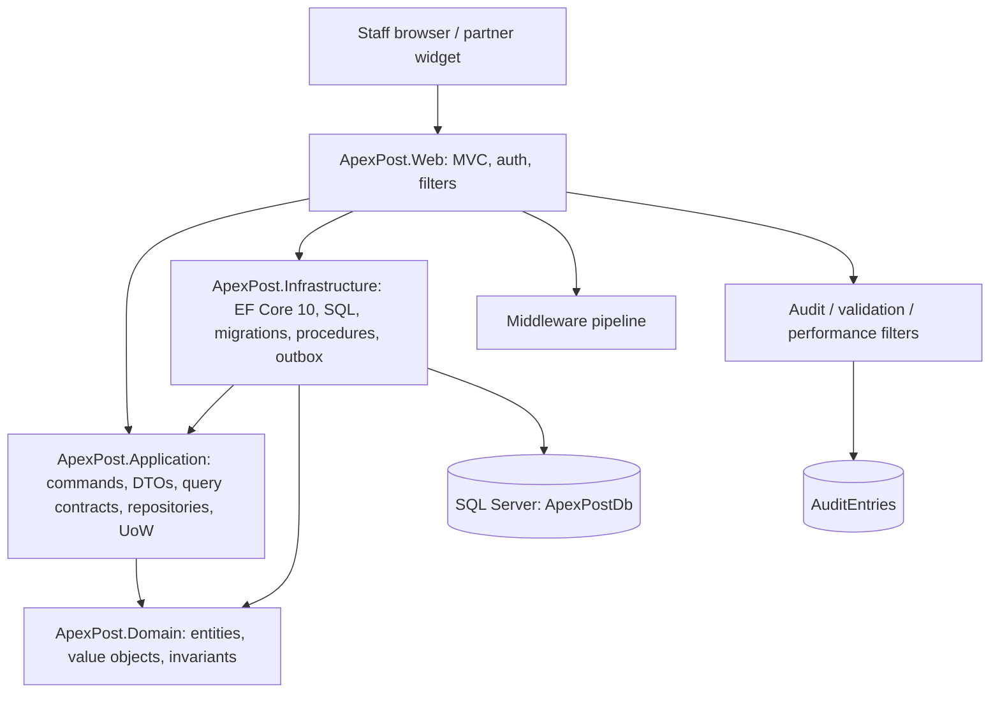
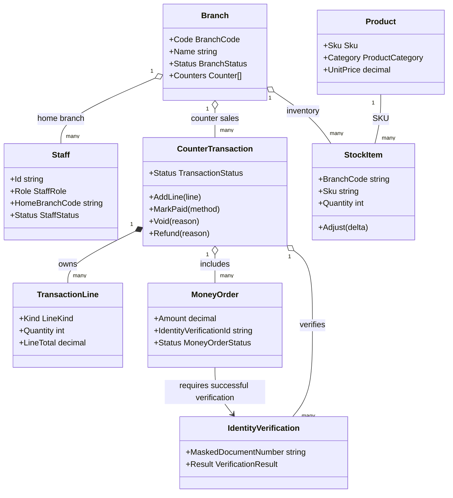
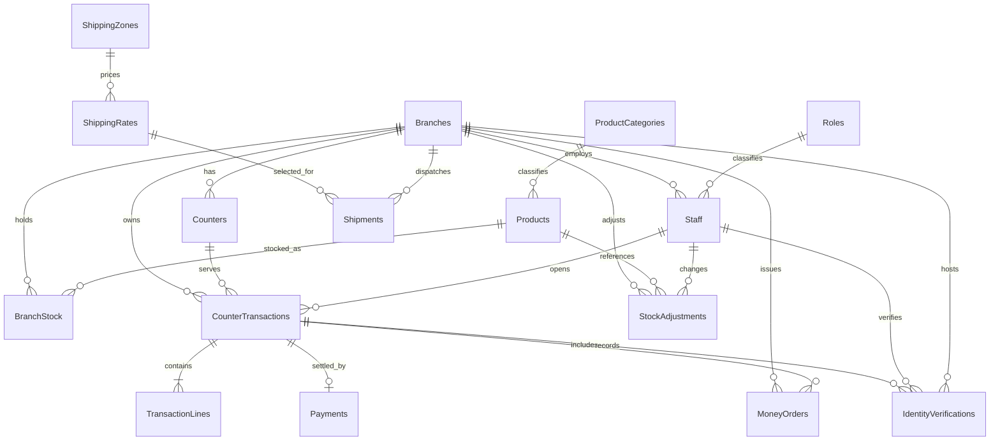
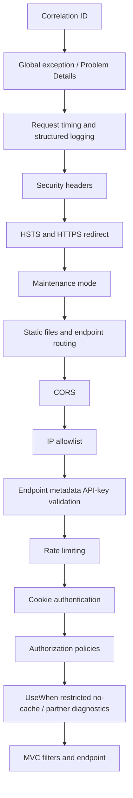

# ApexPost Logistics — Week 03 Design and Architecture

## Assessment evidence status

See [SQL-DESIGN-AND-FLOW.md](SQL-DESIGN-AND-FLOW.md) for the focused relational schema, key data flows, transaction sequences and SQL script catalogue.

This is the continuing ApexPost Counter Platform. Week 2 domain rules, MVC, cookie authentication, middleware, filters and auditing remain in place; Week 3 replaces the JSON persistence boundary with SQL Server and EF Core 10. Source presence is not the same as runtime proof: the .NET SDK and SQL Server were unavailable in the preparation environment, so the Release build, test suite, generated EF idempotent script and actual SQL Server performance measurements still require execution on the target machine. No 100/100 result is claimed without that evidence.

## 1. Goals and architecture

- .NET 10 / C# 14, nullable references enabled, warnings treated as errors.
- SQL Server `ApexPostDb` is the only persistence provider for this week. No database is shared with training workloads.
- Domain has no project references. Application owns use-case contracts, DTOs, repository interfaces and `IUnitOfWork`. Infrastructure implements them with EF Core. Web is the composition root.
- Keep controllers thin, all database I/O asynchronous, cancellation tokens flow to EF, and SQL is parameterized.
- Preserve Week 2 authentication, authorization, middleware, filters, audit trail, shipping and money-order business rules.

`ApexPost.Domain` references nothing. `ApexPost.Application` references Domain only. Infrastructure references Application and Domain. Web references the layers and composes DI. `ApexPostDbContext`, repositories, `IUnitOfWork`, `ICourierService` and the seeder are scoped. `IDbContextFactory` is used for independent query contexts, audit appends, the singleton rate cache and outbox dispatcher. The singleton `RateCache` depends only on the singleton-safe factory (not a scoped repository); the courier service is scoped because it reads shipments through a scoped repository. No static or singleton `DbContext` exists.

## 2. Domain and persistence model

The domain keeps rich entities and behavior for Branch, Staff, Product, StockItem, Shipment, MoneyOrder, IdentityVerification and CounterTransaction. CounterTransaction owns its line collection and lifecycle methods. A mixed basket is composition through `TransactionLine.Kind`; it is not a class-per-line inheritance hierarchy.

Value objects include `Money`, `Weight`, `BranchCode`, `Sku` and `Address`. EF converters are defined in `ValueObjectConverters`: `Money` is used for `Payment.AmountValue`, `Weight` for `Shipment.WeightValue`, and `BranchCode` / `Sku` for the typed key properties of `StockAdjustment`. The platform's monetary currency is INR. Existing application-facing string/decimal properties remain as compatibility accessors where the Week 2 interfaces already expose them.

`IdentityVerificationRecord` is a persistence-only type. `EfIdentityVerificationRepository` maps it to/from the domain `IdentityVerification`. Only a masked document value is persisted; the SQL column is `varchar(8)` with a check requiring a `****` prefix. Raw document numbers are not stored in the database, audit record or log. The identity-verification form records an independent successful/failed verification; a money-order form cannot self-assert success.

`BranchStock.RowVersion` and `CounterTransactions.RowVersion` are SQL Server `rowversion` columns mapped as EF shadow properties. Standard `CreatedAtUtc`, `CreatedBy` and `ModifiedAtUtc` audit columns are mapped as shadow properties where the domain does not need those persistence details. `ApexPostDbContext.SaveChanges/SaveChangesAsync` stamps created/modified UTC values and the system actor fallback; the stock-adjustment procedure and `ExecuteUpdateAsync` price revision explicitly maintain `ModifiedAtUtc` because they bypass tracked SaveChanges. Owned types are used for Branch.Counters and CounterTransaction.Lines.

## 3. Relational schema and integrity

The dedicated database contains:

- `Branches`, `Counters`, `Staff`, `Roles`;
- `Products`, `ProductCategories`, `BranchStock`, `StockAdjustments`;
- `ShippingZones`, `ShippingRates`, `Shipments`;
- `CounterTransactions`, `TransactionLines`, `Payments`;
- `MoneyOrders`, `IdentityVerifications`, `AuditEntries`;
- `OutboxMessages`, `SyncInbox` for durable event publication and idempotent terminal-operation intake.

Primary keys and foreign keys are defined in the initial migration and standalone schema script. Historical/financial relationships use `NO ACTION` / `RESTRICT`; cascading deletion is avoided so a branch, staff member, product or transaction cannot erase financial, stock-adjustment or shipment history. `AuditEntries` deliberately keeps actor/branch identifiers as values without restrictive foreign keys so failed authentication and references to deactivated/missing principals can still be audited. Unique constraints cover BranchCode, SKU, staff email, `(BranchCode, Sku)` stock and one payment per transaction. Checks cover allowed statuses/categories, non-negative stock, positive money-order/payment amounts, positive shipment weights/dimensions, transaction-line quantities/totals and masked identity documents. Money uses `decimal(18,2)`; UTC instants use `datetimeoffset(7)`; codes use `varchar`; display names use `nvarchar`.

Three normalization anomalies prevented:

1. **Update anomaly:** branch name/region is stored once in `Branches`; stock and transactions reference the branch code rather than copying branch details.
2. **Insert/delete anomaly:** product category, role and shipping-zone/rate lookups are independent reference data. Historic transaction lines do not depend on a product row remaining active.
3. **Repeating-group / duplicate-payment anomaly:** basket lines and payments are separate child tables. Keys, unique constraints, checks and transaction boundaries prevent orphan lines, duplicate payments and negative stock.

## 4. EF Core, migrations and data access

`ApexPostDbContext` and per-entity Fluent API configurations live in Infrastructure. `InitialCreate` creates the relational schema, `AddWorkloadIndexes` adds workload indexes, `StoredProcedures` creates reporting/stock procedures, and `OfflineSyncOutbox` creates inbox/outbox persistence. A model snapshot is included. `EnsureCreated()` is not used. The database must exist before EF connects; `database/Create-ApexPostDb.sql` creates the empty database, then `dotnet ef database update` applies migrations.

Application owns specific repository contracts for Branch, Product, Stock, CounterTransaction, Staff, Shipment, MoneyOrder, Payment and AuditStore. The EF repositories stage adds/updates/deletes and never call `SaveChanges`. No repository returns `IQueryable`. `IUnitOfWork` owns the commit boundary. The same scoped context is shared by repositories and the UoW in one request.

Read screens and reports use `IPlatformQueryService` / `IReportService`: `AsNoTracking` projections into response DTOs or parameterized stored-procedure results. Transaction details are fetched with a bounded header projection and one line projection, not N+1 lazy loads. Branch counters and transaction lines are owned collections; no read path uses a broad `Include` graph that multiplies rows. Development EF command logging is enabled. `EfQueryDiagnostics.Capture` uses `ToQueryString()` for low-stock, daily-sales and shipment-search LINQ workloads.

Request/view models are separate from entities. The controller maps validated input into application commands; the service creates/changes domain entities. Client-supplied `Id`, `Status`, `CreatedAtUtc`, `CreatedBy` or audit fields are not accepted as write authority. Product price revision uses `ExecuteUpdateAsync` with a parameterized multiplier and explicit transaction under the SQL Server execution strategy.

## 5. Repository, Unit of Work and command boundaries

- Domain references nothing; Application defines interfaces; Infrastructure implements them; Web composes them.
- Repository methods stage changes only. They do not commit and never expose provider queryables.
- One commit is made per use case. `CounterService.CompleteAsync` stages stock decrements, transaction status and payment, then calls one `SaveChangesAsync`; EF wraps that SaveChanges in a database transaction.
- `MoneyOrderService` stages a new transaction (when required), money-order line and money-order record before the final payment commit. When adding to an existing open basket, it commits the order and line once through `IUnitOfWork`. A failed verification does not commit.
- `EfIdentityVerificationRepository` is the explicit domain/persistence mapper example. Other aggregate models map directly where their domain shape is already suitable.
- Query services may use direct `DbContext` projections in Infrastructure; this is a read-model exception, not a repository write path. Commands and queries use the same database; no separate read database is introduced.

## 6. SQL reports, procedures and transaction integrity

`sql/002_ReportingQueries.sql` includes daily branch sales split by retail/services, branches with no sales (LEFT JOIN), top products by region, shipping volume by zone/service level and money-order/verification counts per branch. `sql/004_SaleTransactionDemo.sql` demonstrates a multi-table atomic sale using `BEGIN TRAN`, `TRY/CATCH`, `SET XACT_ABORT ON`, `XACT_STATE()` and `THROW`. `sql/005_BlockingDemo.sql` demonstrates two-session blocking and READ COMMITTED / row-versioning behavior. Deadlock risk is reduced by short transactions and a consistent sorted SKU update order; remote courier calls occur before the database transaction.

Stored procedures use `CREATE OR ALTER`, `SET NOCOUNT ON`, parameter validation and meaningful `THROW` errors:

- `usp_DailyBranchSales` is a stable reporting result used by the daily branch-sales screen.
- `usp_LowStockReport` supports optional branch filtering and a configurable threshold. It uses `OPTION (RECOMPILE)` because all-branch and single-branch selectivity differ; compilation overhead must be checked against measured call frequency.
- `usp_AdjustStock` owns the atomic quantity/history write with `XACT_ABORT`, `TRY/CATCH`, `XACT_STATE()` and `THROW`.
- Shipping-volume and money-order-audit procedures provide stable auditor report shapes.

EF calls use interpolated/parameterized APIs only (`Database.SqlQuery` / `ExecuteSqlInterpolatedAsync`); no user input is concatenated into SQL. `sql/009_LeastPrivilege.sql` creates a least-privilege application role with the required procedure execution and table permissions; production credentials belong in a secret store.

## 7. Indexes and performance evidence

Candidate indexes cover low stock by branch/quantity, daily sales by branch/status/date, shipment search by zone/service/date, money-order audit by branch/date, identity verification by branch/date, open transactions and stock-adjustment history. Key order follows equality predicates before range/order predicates; INCLUDE columns cover the narrow projections. Indexes have write and storage cost and should be retained only if measurements justify them.

`PERFORMANCE.md` provides the baseline/after capture process, SARGable half-open date-range rewrite, Query Store/statistics investigation and result tables. **No logical-read, CPU, elapsed-time, plan-shape, storage or estimated/actual-row numbers are invented.** Capture actual `.sqlplan` files and `SET STATISTICS IO/TIME` output against the seeded SQL Server database before claiming performance improvement. A small dataset may correctly produce scans.

## 8. Stock concurrency, transaction lifecycle and exceptions

Stock is not reserved when an item is merely added to an open basket. At payment, the service reads required stock rows, checks availability, decrements them, marks the transaction paid and inserts the payment in one SaveChanges transaction. Two clerks attempting to sell the last unit contend on `rowversion`; one stale update raises `DbUpdateConcurrencyException`, mapped to HTTP 409 Problem Details. SQL check constraints independently prevent negative quantity.

Only a Paid transaction can transition to Voided or Refunded. The branch manager/admin operation restores each retail line's stock and updates transaction/money-order state in the same commit. Repeating a void/refund is rejected by the state transition and rowversion. High-value money orders require a successful verification tied to the same transaction and branch. Exceptions map to 409 for concurrency/unique conflicts, 404 for missing resources and 400 for domain validation.

## 9. Middleware and MVC filters

The request pipeline in `Program.cs` is:

1. Correlation ID middleware.
2. Global exception/Problem Details middleware.
3. Structured request timing/logging middleware.
4. Security headers (`OnStarting`).
5. HSTS outside Development and HTTPS redirection.
6. Maintenance mode (503 with `Retry-After`, health remains available).
7. Static files and routing.
8. CORS for the approved partner widget origin.
9. IP allowlist middleware using the connection address (not spoofable forwarded headers).
10. Endpoint-metadata API-key validation with constant-time comparison; missing/invalid key is 401, unconfigured server key is 500.
11. Login and partner rate limiting (429).
12. Cookie authentication and authorization policies.
13. `UseWhen` adds no-cache headers to restricted MVC endpoints and partner-only response diagnostics/marker after API-key validation; `Map` + `Run` serves `/health/live`; `MapHealthChecks` serves `/health`; MVC route mapping follows.

Forwarded headers are not trusted by default. Behind a proxy, configure `KnownProxies` / `KnownNetworks` and apply forwarded-header processing before IP restriction and HTTPS decisions. CORS is not an authentication boundary.

| Concern | Implementation | Why |
|---|---|---|
| Correlation ID | Middleware | Applies to MVC, health and integration requests before routing. |
| Exception / Problem Details | Middleware | Catches failures from the whole downstream pipeline and maps persistence exceptions consistently. |
| Request timing/logging | Middleware | Measures every request, including routing, authorization and failures. |
| Security headers, HSTS, HTTPS | Middleware / hosting | Applies uniformly to all responses and must run before endpoints. |
| Maintenance mode | Middleware | Can short-circuit any endpoint while preserving health paths. |
| IP allowlist and API key | Middleware | Protects endpoint metadata and partner traffic before controller execution. |
| Authentication and authorization | ASP.NET Core middleware | Establishes claims and enforces endpoint policies before MVC. |
| Audit | `IAsyncActionFilter` | Needs MVC controller/action, route values, action arguments, result status and duration. |
| Validation | Action filter | Needs MVC `ModelState`; it must let MVC forms redisplay rather than return API JSON. |
| Action performance | Action filter | Measures MVC action execution separately from middleware/transport time. |

`AuditActionFilter` is MVC-aware and records actor, role, branch, controller/action, safe route values, result, duration and correlation ID. Void/refund reasons are normalized, bounded and long digit sequences redacted. It never records passwords, API keys, full document numbers or card data. `EfAuditStore` uses a separate context so audit failures do not roll back the business transaction. The validation filter returns API validation details for API controllers but allows MVC actions to redisplay their form with `ModelState`; the performance filter logs slow actions. These concerns are filters because they need MVC action arguments/results/model state, whereas request-wide concerns stay in middleware.

| Threat / failure mode | Mitigation |
|---|---|
| Brute-force staff login | Login fixed-window rate limit, PBKDF2 password hashes and generic failure response. |
| Cross-branch data access | Claims-based branch policy plus service-level staff/branch checks on every transaction. |
| Forged integration request | Endpoint metadata, secret-configured API key, constant-time comparison and partner rate limit. |
| Spoofed client IP | Use `RemoteIpAddress`; forwarded headers are ignored unless trusted proxy/network configuration is explicitly supplied. |
| XSS, framing and MIME sniffing | CSP, `X-Frame-Options`, `X-Content-Type-Options`, Referrer-Policy and Permissions-Policy. |
| CSRF against cookie-authenticated forms | Antiforgery validation on MVC form POSTs and secure SameSite cookies. |
| Identity/payment data leakage | Mask document numbers before persistence; do not log request bodies, passwords, API keys or card data; EF sensitive-data logging remains disabled. |
| Concurrent sale of last stock | SQL rowversion, quantity check constraint and one SaveChanges transaction; stale write maps to 409. |
| Duplicate offline operation | Unique `(ClientId, OperationId)` inbox key and at-least-once outbox consumers deduplicating by message ID. |

## 10. Offline-first foundations

`ChangeTrackingOutboxInterceptor` creates a safe event envelope in `OutboxMessages` in the same SaveChanges transaction as aggregate changes. `OutboxDispatcher` is a simulated publisher; production transport is a later integration. Consumers must deduplicate by outbox message ID because delivery is at-least-once.

The offline sync endpoint accepts a client/terminal identity and operation ID, stores the request in `SyncInbox` with a unique `(ClientId, OperationId)` key, and returns the existing result for duplicates. Financial/stock operations use server-wins/refresh; non-financial conflicts require review. The endpoint rejects payload fields that could carry full document numbers, API keys or passwords. This week delivers the SQL outbox/inbox and idempotent intake foundation; it does not claim a completed MAUI local database, background network transport or automatic replay of every aggregate mutation.

## 11. Architecture Decision Records and SOLID mapping

Week 2 decisions ADR-001 through ADR-008 are retained as historical context. Week 3 decisions ADR-009 through ADR-016 are the current database and persistence decisions. In particular, ADR-002 (JSON persistence) and ADR-007 (JSONL audit adapter) describe the earlier Week 2 implementation and are superseded by the SQL Server decisions; they are not the active Week 3 persistence design.

| ADR | Decision area | Assessment relevance |
|---|---|---|
| [ADR-009](docs/adr/ADR-009-sql-schema-and-delete-behaviour.md) | Relational schema, constraints and delete behavior | Schema design / integrity |
| [ADR-010](docs/adr/ADR-010-workload-indexes.md) | Workload-driven index selection | Index strategy and evidence |
| [ADR-011](docs/adr/ADR-011-stored-procedures.md) | Stored procedure boundaries | Stored procedures / safe SQL |
| [ADR-012](docs/adr/ADR-012-repository-unit-of-work.md) | Repository and Unit of Work boundaries | Repository / transaction ownership |
| [ADR-013](docs/adr/ADR-013-domain-persistence-separation.md) | Domain and persistence model separation | DTOs / model mapping |
| [ADR-014](docs/adr/ADR-014-stock-concurrency-and-offline-conflicts.md) | Stock concurrency and conflict policy | EF concurrency / transactions |
| [ADR-015](docs/adr/ADR-015-audit-and-outbox-boundaries.md) | Audit and outbox transaction boundaries | Audit reliability / atomicity |
| [ADR-016](docs/adr/ADR-016-use-case-atomicity-and-read-model-dtos.md) | Use-case atomicity and read DTO projections | Unit of Work / query boundary |

### SOLID mapping

- **Single Responsibility:** Domain owns invariants; Application owns use-case orchestration; Infrastructure owns persistence; Web owns transport, authentication and composition.
- **Open/Closed:** Application contracts allow alternate repository, audit, query and courier adapters without changing domain rules.
- **Liskov Substitution:** Infrastructure implementations honor Application contracts and do not leak EF-specific queryables to callers.
- **Interface Segregation:** Counter, stock, reporting, audit, repository and Unit of Work contracts are separated by use case.
- **Dependency Inversion:** High-level Application policies depend on abstractions; Infrastructure implements those abstractions; Web composes the graph at startup.

## 12. Known verification limits

- Run `dotnet restore`, Release build and all unit/integration tests with .NET 10.
- SQL Server integration tests require a disposable LocalDB/SQL Server database and permission to create/drop databases.
- Generate the authoritative idempotent migration script with `dotnet ef migrations script --idempotent`; the checked-in deployment fallback is explicitly labelled hand-maintained.
- Capture real execution plans, IO/TIME, storage and estimated-vs-actual row evidence in `database/evidence/`.
- Review the actual Git branches/PR/commit history in the repository; a ZIP does not contain `.git` history.
- Courier status/rates and outbox publication remain simulated; no real carrier or partner transport is claimed.
