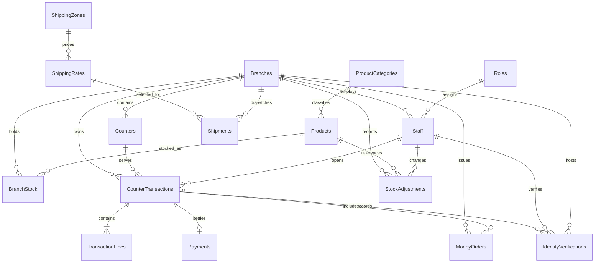
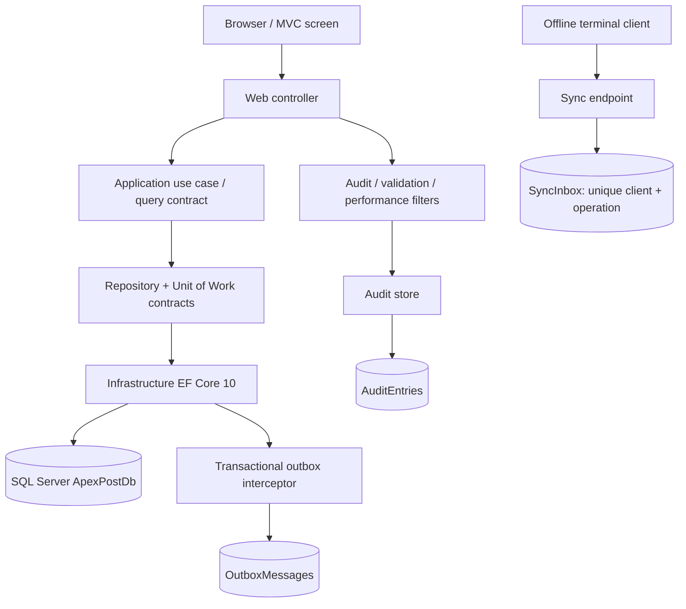
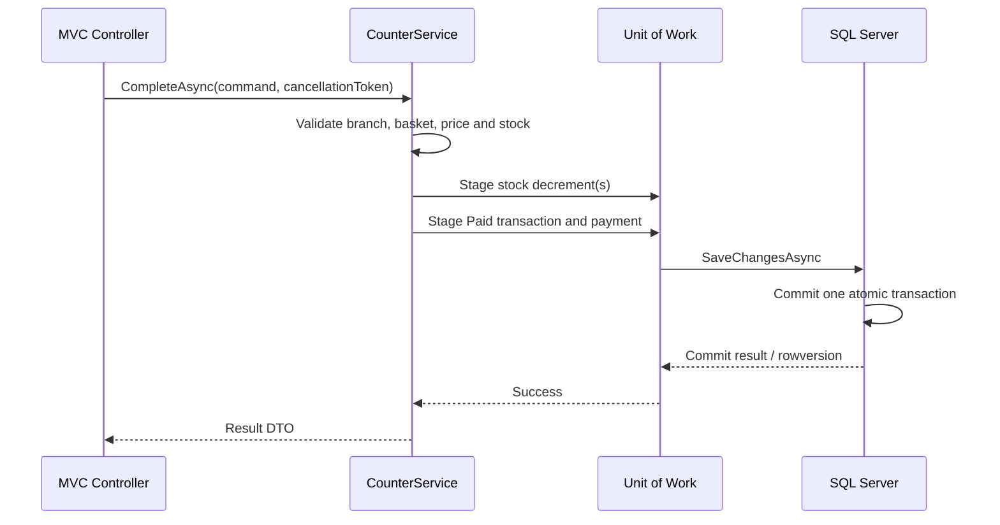

# SQL Design and Data Flow
## ApexPost Counter Platform — Week 03

**Database:** `ApexPostDb` · **Provider:** SQL Server · **ORM:** EF Core 10  
**Purpose:** Explain the relational model, integrity rules, query/write paths, migration strategy and SQL evidence expected by the assessment.

---

## 1. Design principles

1. SQL Server is the sole persistence provider for this assessment.
2. Relational tables represent independent business concepts; repeating collections are represented as child rows.
3. Primary keys, foreign keys, unique constraints, check constraints and transaction boundaries enforce integrity at the database boundary as well as in domain code.
4. Historical and financial records are retained. Physical deletion is not the normal lifecycle for branches, staff, products or transactions.
5. Every data operation is asynchronous where supported and receives a `CancellationToken`.
6. SQL uses EF Core LINQ, parameterized interpolated APIs or parameterized stored procedures. Never concatenate user input into SQL.
7. Read models may be projected directly by Infrastructure query services. Command writes pass through Application services, repositories and Unit of Work.
8. Identity documents are masked before persistence. Raw document values must never enter database rows, logs or audit entries.

---

## 2. Logical schema

The schema is organized into the following subject areas.

| Subject area | Tables | Purpose |
|---|---|---|
| Organization and access | `Branches`, `Counters`, `Roles`, `Staff` | Branch ownership, counter locations, role assignment and staff identity. |
| Catalogue and stock | `ProductCategories`, `Products`, `BranchStock`, `StockAdjustments` | Product master data, branch-level quantities and auditable stock changes. |
| Counter sales | `CounterTransactions`, `TransactionLines`, `Payments` | Basket header, retail/service lines and settlement record. |
| Shipping | `ShippingZones`, `ShippingRates`, `Shipments` | Zone/service pricing and shipment lifecycle data. |
| Financial compliance | `MoneyOrders`, `IdentityVerifications` | Money-order issue and associated identity-verification evidence. |
| Audit and integration | `AuditEntries`, `OutboxMessages`, `SyncInbox` | Security/business audit, reliable event capture and idempotent terminal sync intake. |

### Entity relationship diagram

`AuditEntries`, `OutboxMessages` and `SyncInbox` are operational records and are not shown as restrictive ownership relationships in this business ER view. Confirm the exact column-level relationships in `ApexPostDbContext`, Fluent configurations and migration `202611010001_InitialCreate`.

---

## 3. Keys, constraints and delete policy

| Rule | Database mechanism | Reason |
|---|---|---|
| Branch code is unique | Unique constraint/index on `Branches.Code` | Prevents duplicate branch identifiers. |
| Product SKU is unique | Unique constraint/index on `Products.Sku` | Provides stable product identity. |
| Staff email is unique | Unique constraint/index on staff email | Prevents ambiguous staff login identity. |
| One stock row per branch/SKU | Composite unique key on `(BranchCode, Sku)` | Prevents duplicate stock balances. |
| One payment per transaction | Unique key on payment transaction reference | Prevents duplicate settlement rows. |
| Stock cannot become negative | Check constraint on quantity | Last line of defence against invalid inventory. |
| Positive monetary/quantity values | Check constraints | Protects financial and operational invariants. |
| Masked identity only | Bounded `varchar(8)` and mask check | Prevents storage of a full identity document number. |
| Stale stock/transaction write | SQL Server `rowversion` | Detects concurrent updates. |

### Delete behaviour

Use `NO ACTION` / restrictive foreign-key behaviour for historical, financial and audit-sensitive relationships. A branch, staff member, product or transaction must not be physically deleted if doing so would erase stock adjustments, payments, shipment history or counter records. Use lifecycle state such as inactive/closed/archived where appropriate.

Audit actor/branch identifiers are intentionally retained as audit facts rather than requiring a live principal row; audit history must remain available when a staff account is deactivated or removed from the operational directory. Verify each concrete FK delete action against the generated migration and live SQL Server metadata before submission.

### Normalization rationale

- Branch attributes live once in `Branches`; dependent tables store a branch key rather than copied branch names/regions.
- Categories, roles, zones and service rates are lookup/master data rather than repeated text in transactional rows.
- Transaction headers, transaction lines and payments are separate relations. This avoids repeating groups and supports one settlement per transaction.
- Historic transaction lines preserve sale-time description/price facts so a later catalogue edit does not rewrite past sales.

---

## 4. Data access architecture

### Dependency direction

- Domain has no project reference.
- Application references Domain and owns use-case contracts.
- Infrastructure references Application and Domain and implements persistence.
- Web references the application layers and Infrastructure only to compose dependencies in `Program.cs`.
- DbContext, repositories and Unit of Work are scoped. No static/singleton DbContext is used.

### Command path

Controllers bind request models and pass validated commands to Application services. Application services enforce use-case sequencing and domain rules. Repositories stage changes; they do not call `SaveChanges`. The Unit of Work commits once at the use-case boundary.

### Query path

MVC screens and reports use `IPlatformQueryService` / report services. Infrastructure may project directly from `DbContext` into DTOs using `AsNoTracking`; this is a deliberate read-model optimization. Repositories do not return `IQueryable`, and controllers do not issue EF queries.

---

## 5. Critical write flows

### 5.1 Complete a counter sale

The stock decrement, transaction state transition, transaction lines and payment must commit together. If any constraint, concurrency check or persistence operation fails, the database transaction rolls back the entire unit. A failed sale must not leave stock decremented or a paid transaction without its payment.

### 5.2 Stock concurrency

`BranchStock.RowVersion` is the optimistic concurrency token. Two clerks may read the same quantity, but only one update using the original rowversion can win. EF raises `DbUpdateConcurrencyException` for the stale writer; exception mapping returns HTTP 409 Problem Details. A SQL check constraint independently prevents negative stock.

### 5.3 Void or refund

Only eligible paid transactions may transition to void/refund. The operation restores eligible retail stock and updates transaction/payment-related state within one use-case commit. Domain lifecycle rules and rowversion prevent duplicate restoration. The Branch Manager authorization requirement is enforced before the operation is invoked.

### 5.4 Money order and identity verification

Identity verification is recorded independently. A money-order request cannot self-assert a successful verification. The verification must be successful and linked to the same transaction and branch where required by the application rule. Only a masked document value is persisted; logs and audit events must not contain raw identity document data.

### 5.5 Audit write

`AuditActionFilter` submits a safe audit record through `IAuditStore`. The EF audit adapter uses an independent context/commit so an audit-store outage does not roll back the business transaction. This is a deliberate reliability trade-off: audit append failure is logged/observable and must not silently expose sensitive request data. Do not claim the audit record is atomically committed with the business row; the chosen boundary is documented in ADR-015.

### 5.6 Outbox and offline intake

The change-tracking interceptor writes safe outbox envelopes in the same `SaveChanges` transaction as tracked aggregate changes. The dispatcher is currently simulated; it is not a production broker integration. `SyncInbox` uses a unique `(ClientId, OperationId)` key to deduplicate repeated terminal requests.

---

## 6. Reporting and stored-procedure policy

| Workload | Implementation | Why |
|---|---|---|
| Dashboard and catalogue/stock screens | EF Core no-tracking DTO projections | Flexible screen-specific filtering and projection. |
| Daily branch sales | `usp_DailyBranchSales` | Stable aggregate/report contract reused by report consumers. |
| Low-stock report | `usp_LowStockReport` | Optional branch/threshold parameters and measured-plan investigation point. |
| Shipping volume by zone/service level | Stored procedure/report query | Stable grouped report with predictable parameters. |
| Money orders and identity verifications by branch | Stored procedure/report query | Stable audit/report aggregation. |
| Atomic stock adjustment | `usp_AdjustStock` | Keeps quantity and stock-history write in one SQL transaction. |

Stored procedures use `CREATE OR ALTER`, `SET NOCOUNT ON`, parameter validation and meaningful SQL errors. EF calls use parameterized APIs such as `Database.SqlQuery<T>` and `ExecuteSqlInterpolatedAsync`. Never concatenate request values into SQL text.

Use `sql/002_ReportingQueries.sql` for join/grouping examples and `sql/003_StoredProcedures.sql` for procedure definitions. `sql/004_SaleTransactionDemo.sql` demonstrates explicit T-SQL transaction handling.

---

## 7. Index design

The key-order rule is equality predicates first, then range/order columns; `INCLUDE` columns cover narrow projections where appropriate.

| Workload | Candidate index | Design rationale |
|---|---|---|
| Low stock by branch | `(BranchCode, Quantity) INCLUDE (Sku)` | Branch equality, then quantity range. |
| Daily sales | `(BranchCode, Status, CompletedAt) INCLUDE (Total)` | Equality predicates before date range. |
| Shipment search | `(DestinationZone, ServiceLevel, CreatedAt DESC)` with report projection columns included | Equality filters and newest-first retrieval. |
| Money-order audit | `(BranchCode, CreatedAt DESC)` with report columns included | Branch-scoped chronological lookup. |
| Verification audit | `(BranchCode, VerifiedAt DESC)` with outcome/transaction columns included | Branch-scoped verification history. |
| Stock adjustment history | `(BranchCode, ChangedAtUtc DESC)` with SKU/delta/actor included | Branch manager audit history. |
| Open transactions | Filtered index for open status | Avoids indexing closed/paid history for the open-basket path. |

These are candidate/workload-driven choices, not proof of performance. Indexes consume storage and add insert/update/delete cost. Use `PERFORMANCE.md` and `sql/008_PerformanceCapture.sql` to compare actual plans, logical reads, CPU/elapsed time, index usage and estimated-versus-actual rows. Retain or change indexes based on measured evidence.

---

## 8. Migration and deployment sequence

1. Create the empty `ApexPostDb` with `database/Create-ApexPostDb.sql`.
2. Configure `ConnectionStrings:ApexPost` through user-secrets.
3. Inspect migrations and model snapshot.
4. Apply EF migrations using `dotnet ef database update`.
5. Generate the idempotent script with `dotnet ef migrations script --idempotent`.
6. Review the generated SQL and compare it with the target schema.
7. Run the seeding service on a clean development/test database.
8. Execute reporting procedures and validate expected result sets.
9. Capture SQL Server actual plans and IO/TIME evidence.

Migration source of truth is `src/ApexPost.Infrastructure/Data/Migrations`; the checked-in `database/migrations/ApexPostDb-idempotent.sql` is labelled a hand-maintained fallback until regenerated with the EF CLI. Never delete migrations to make tests pass, manually remove schema columns, or generate a new migration before understanding the model/schema difference.

---

## 9. SQL script catalogue

| Script | Use |
|---|---|
| `database/Create-ApexPostDb.sql` | Create the empty dedicated database. |
| `database/migrations/001_InitialCreate.sql` | Initial schema reference/deployment script. |
| `database/migrations/002_WorkloadIndexes.sql` | Index deployment script. |
| `database/migrations/003_StoredProcedures.sql` | Procedure deployment script. |
| `database/migrations/004_OfflineSyncOutbox.sql` | Outbox/inbox deployment script. |
| `database/migrations/ApexPostDb-idempotent.sql` | Hand-maintained idempotent fallback. |
| `sql/001_CreateSchema.sql` | Standalone schema reference; do not combine with EF migration creation on the same database. |
| `sql/002_ReportingQueries.sql` | Reporting joins and aggregations. |
| `sql/003_StoredProcedures.sql` | Stored procedures. |
| `sql/004_SaleTransactionDemo.sql` | Atomic sale and rollback demonstration. |
| `sql/005_BlockingDemo.sql` | Two-session blocking demonstration. |
| `sql/006_CandidateIndexes.sql` | Workload index candidates. |
| `sql/007_OfflineSync.sql` | Offline sync reference. |
| `sql/008_PerformanceCapture.sql` | Plan, IO/TIME and storage evidence capture. |
| `sql/009_LeastPrivilege.sql` | Database role and permissions. |

---

## 10. Assessment evidence still required

The repository contains source definitions and test cases, but source presence is not runtime proof. Complete and retain:

- SQL Server migration apply and rollback/recovery review.
- Integration tests against a disposable SQL Server database.
- Stored procedure output verification using seeded expected totals.
- Two-session blocking/isolation observation.
- Actual `.sqlplan` files and `SET STATISTICS IO/TIME` output for at least four workloads.
- Before/after index storage and write-cost observations.
- Actual EF `ToQueryString()` samples.
- Release build with zero warnings/errors and complete test output.

Do not invent performance numbers or claim all tests passed without the test-run evidence.
