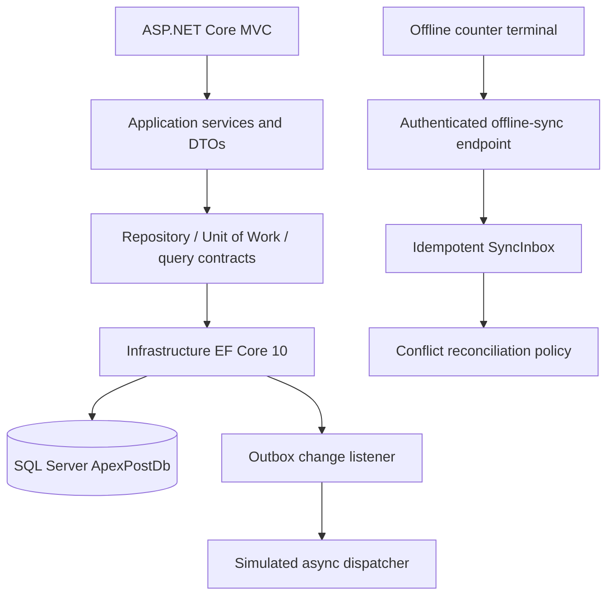

# Week 03 data-access flow



The application layer owns contracts and use cases. Infrastructure owns `ApexPostDbContext`, Fluent mappings, SQL Server repositories, stored-procedure calls, migrations, the audit store, the change-tracking interceptor and the offline inbox/outbox persistence. The web project composes these services.

The offline sync endpoint durably accepts and deduplicates operations; it does not blindly overwrite financial aggregates. Stock/payment/transaction conflicts use server-wins plus terminal refresh. Other aggregate conflicts are marked for manual review. A production terminal still needs its local durable store and a real transport adapter; this Week 03 slice supplies the server-side inbox/outbox contract and simulated dispatcher, not a complete MAUI offline client.
```
